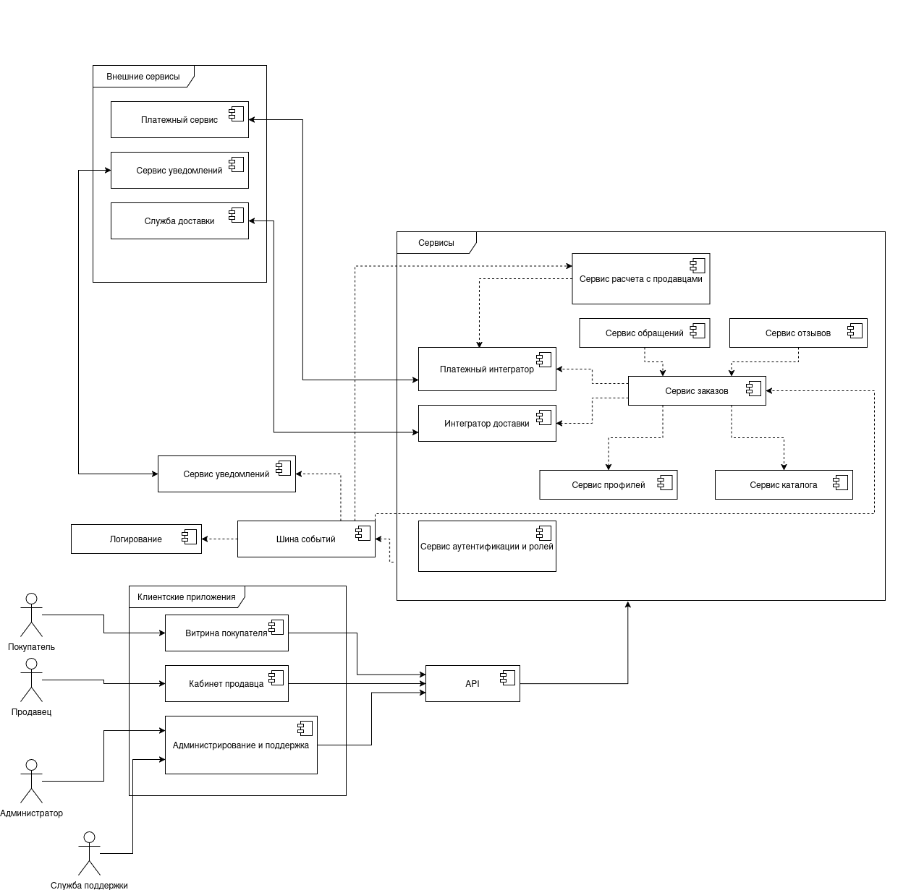

# Архитектура (HLA)

## Назначение

Документ описывает High-Level Architecture системы «Сервис онлайн-маркетплейса»: какие компоненты нужны для выполнения задач системы и как они взаимодействуют. Основание — КБП из [kpb.md](kpb.md) и контекст из [context.md](context.md).

Архитектура приведена без учёта кибериммунного подхода: компоненты выделены только по целевым функциям. Вопросы доверия, изоляции и доменов безопасности рассматриваются на следующих этапах.

## Диаграмма

На диаграмме пунктирные стрелки соединяют компоненты внутри платформы, сплошные — пользователей, клиентские приложения и внешние сервисы. Стрелка от API к блоку «Сервисы» означает запрос к нужному сервису внутри блока. Стрелка от блока «Сервисы» к шине событий означает публикацию событий всеми сервисами.

## Описание компонентов

### Клиентские приложения

| Компонент | Назначение | Связанные ценности КБП | Комментарии |
|---|---|---|---|
| Витрина покупателя | Интерфейс покупателя: просмотр каталога, корзина, оформление и оплата заказа, отзывы, статусы заказов | Каталог товаров и цены, данные заказов, отзывы и рейтинги | Веб-клиент и мобильное приложение. Своих данных не хранит, все запросы отправляет в API |
| Кабинет продавца | Интерфейс продавца: управление товарами и ценами, обработка заказов, баланс и выплаты | Каталог товаров и цены, данные заказов, средства и расчёты продавцов, учётные записи продавцов | Продавец видит только данные своего магазина |
| Администрирование и поддержка | Интерфейс администратора (настройки, роли, модерация) и службы поддержки (обращения, споры, статусы заказов) | Учётные записи администраторов, данные заказов | Администратор и поддержка различаются ролями, а не разными приложениями |

### API

| Компонент | Назначение | Связанные ценности КБП | Комментарии |
|---|---|---|---|
| API | Единая точка входа для клиентских приложений: приём запросов, проверка токена через сервис аутентификации, маршрутизация запросов в сервисы, передача сервисам идентификатора и роли пользователя | Все (транзитом) | Бизнес-логики не содержит. Остальные сервисы с сервисом аутентификации не общаются |

### Сервисы платформы

| Компонент | Назначение | Связанные ценности КБП | Комментарии |
|---|---|---|---|
| Сервис аутентификации и ролей | Регистрация и вход, сессии и токены, роли и права покупателей, продавцов, администраторов | Учётные записи продавцов, учётные записи администраторов | Владелец учётных данных. Хранит хэши паролей. События входов и смены ролей публикует в шину |
| Сервис профилей | Контакты и адреса покупателей и продавцов | Персональные данные покупателей и продавцов | Владелец персональных данных. Выдаёт их сервису заказов по запросу |
| Сервис каталога | Товары, описания, цены, остатки, модерация, история изменений | Каталог товаров, цены | Изменять карточки может только продавец-владелец и модератор |
| Сервис заказов | Корзина, оформление заказа, жизненный цикл статусов (ожидание оплаты, комплектация, доставка, выполнен, возврат, приостановлен) | Данные заказов | Оркестрирует оформление: каталог, профили, оплата, доставка. Статусы заказа обновляет по событиям оплаты и доставки из шины |
| Платежный интегратор | Обмен с внешним платёжным сервисом: инициация платежей, приём результатов, возвраты, выплаты | Данные для проведения платежей | Полных данных карты не хранит: ввод карты на стороне платёжного сервиса. Хранит идентификаторы и статусы операций |
| Сервис расчета с продавцами | Начисления продавцам по выполненным заказам, баланс, запросы на вывод средств, лимиты, сверка | Средства и расчёты продавцов | Начисляет деньги по событию «заказ выполнен». Выплаты проводит через платёжный интегратор |
| Интегратор доставки | Передача адреса и состава заказа службе доставки, приём статусов доставки | Данные заказов, персональные данные | Передаёт службе доставки только необходимый минимум данных |
| Сервис отзывов | Приём и показ отзывов, расчёт рейтингов | Отзывы и рейтинги | Проверяет у сервиса заказов, что отзыв привязан к выполненному заказу |
| Сервис обращений | Обращения покупателей и продавцов, разбор споров | Данные заказов | Просматривает заказы и меняет их статусы через сервис заказов |

### События, уведомления и журналирование

| Компонент | Назначение | Связанные ценности КБП | Комментарии |
|---|---|---|---|
| Шина событий | Асинхронная доставка событий между сервисами | Данные заказов, события безопасности | Принимает события от всех сервисов. Передаёт их подписчикам: сервису заказов, сервису расчета, сервису уведомлений и логированию |
| Сервис уведомлений (внутренний) | Формирование писем по шаблонам и отправка через внешний сервис уведомлений | Персональные данные (email) | Получает события из шины. Адрес и имя запрашивает у сервиса профилей |
| Логирование | Приём событий безопасности и действий пользователей, хранение журналов | Логи и события безопасности | Только запись и чтение, изменение и удаление записей не предусмотрены. Нужны резервные копии |

### Внешние сущности и сервисы

| Компонент | Назначение | Связанные ценности КБП | Комментарии |
|---|---|---|---|
| Покупатель | Выбирает товары, оформляет заказы, оплачивает, оставляет отзывы | Персональные данные покупателей, данные заказов | Работает только через витрину |
| Продавец | Размещает товары, обрабатывает заказы, получает выплаты | Каталог, данные заказов, расчёты продавцов | Работает только через кабинет продавца |
| Администратор | Управляет платформой, ролями, настройками | Учётные записи администраторов | Работает через «Администрирование и поддержка» |
| Служба поддержки | Решает споры и обрабатывает обращения | Данные заказов | Работает через «Администрирование и поддержка» |
| Платежный сервис | Проводит платежи, возвраты и выплаты | Данные для проведения платежей | Внешняя система |
| Служба доставки | Доставляет заказы, сообщает статусы | Данные заказов | Внешняя система |
| Сервис уведомлений (внешний) | Отправляет письма пользователям | Персональные данные (email) | Внешняя система |

## Основные взаимодействия

### Пользователи, клиенты и API

| Откуда | Куда | Что передаётся |
|---|---|---|
| Покупатель | Витрина покупателя | Действия пользователя: поиск, корзина, оформление заказа, отзывы |
| Продавец | Кабинет продавца | Товары, цены, статусы заказов |
| Администратор | Администрирование и поддержка | Настройки, роли, модерация |
| Служба поддержки | Администрирование и поддержка | Ответы на обращения, смена статусов заказов |
| Витрина покупателя, Кабинет продавца, Администрирование и поддержка | API | Запросы пользователя и токен сессии |
| API | Сервис аутентификации и ролей | Токен для проверки, запросы входа и управления ролями. В ответ: идентификатор пользователя и роль |
| API | Остальные сервисы платформы | Запрос с идентификатором пользователя и ролью |

### Запросы между сервисами

| Откуда | Куда | Что передаётся |
|---|---|---|
| Сервис заказов | Сервис профилей | Запрос адреса и контактов покупателя |
| Сервис заказов | Сервис каталога | Проверка наличия и актуальной цены |
| Сервис заказов | Платежный интегратор | Сумма и идентификатор заказа, запросы на возврат |
| Сервис заказов | Интегратор доставки | Адрес и состав заказа |
| Сервис отзывов | Сервис заказов | Проверка, что заказ выполнен и принадлежит автору отзыва |
| Сервис обращений | Сервис заказов | Просмотр заказа, смена статуса |
| Сервис расчета с продавцами | Платежный интегратор | Запрос на выплату продавцу |

### События

| Откуда | Куда | Что передаётся |
|---|---|---|
| Сервисы платформы | Шина событий | События о значимых действиях: заказ создан, оплата прошла, статус доставки, заказ выполнен, вход пользователя, смена роли и др. |
| Шина событий | Сервис заказов | События оплаты и доставки для обновления статуса заказа |
| Шина событий | Сервис расчета с продавцами | Событие «заказ выполнен» для начисления продавцу |
| Шина событий | Сервис уведомлений (внутренний) | События, по которым нужно отправить письмо |
| Шина событий | Логирование | Все события для журнала |

### Внешние системы

| Откуда | Куда | Что передаётся |
|---|---|---|
| Платежный интегратор | Платежный сервис | Сумма и идентификатор заказа; запросы возврата и выплаты. В ответ: результат операции |
| Интегратор доставки | Служба доставки | Адрес и состав заказа. В ответ: статусы доставки |
| Сервис уведомлений (внутренний) | Сервис уведомлений (внешний) | Email получателя, шаблон сообщения. В ответ: статус отправки |