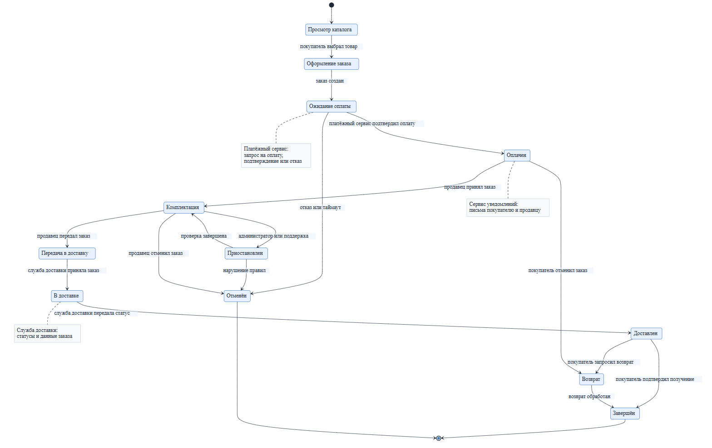

# Контекст

## Назначение

Документ фиксирует границы системы «Сервис онлайн-маркетплейса» и её взаимодействие с внешними сущностями. Основание — КБП из [kpb.md](kpb.md).

## Границы системы

Внутри системы: витрина и каталог, оформление и сопровождение заказов, интеграция с платежами и доставкой, кабинет продавца, администрирование, поддержка и уведомления.

Снаружи системы: покупатель, продавец, платёжный сервис, служба доставки, сервис уведомлений, администратор и служба поддержки.

## Внешние сущности

| Сущность | Роль | Взаимодействие с системой |
|---|---|---|
| Покупатель | Выбирает товары, оформляет заказы, оплачивает, оставляет отзывы | Передаёт контакты, адрес и данные заказа; получает статусы и уведомления |
| Продавец | Размещает товары, обрабатывает заказы | Передаёт каталог, цены и статусы; получает данные заказов |
| Платёжный сервис | Проводит платежи и возвраты | Получает сумму и идентификатор заказа; возвращает результат операции |
| Служба доставки | Доставляет заказы | Получает адрес и состав заказа; возвращает статусы доставки |
| Сервис уведомлений | Отправляет письма | Получает адрес получателя и шаблон сообщения |
| Администратор | Управляет платформой и правами | Изменяет настройки, роли и статусы заказов |
| Служба поддержки | Решает споры и обрабатывает обращения | Просматривает заказы и обращения, меняет статусы |

## Диаграмма состояний

Диаграмма описывает основной жизненный цикл заказа.

## Комментарии по взаимодействиям

| Этап | Внешняя сущность | Данные | Связанная ценность КБП |
|---|---|---|---|
| Просмотр каталога | Покупатель | Каталог, цены | Каталог товаров, цены |
| Оформление заказа | Покупатель | Состав, сумма, адрес, контакты | Персональные данные, данные заказов |
| Ожидание оплаты | Платёжный сервис | Сумма, идентификатор заказа, результат оплаты | Данные для проведения платежей |
| Комплектация | Продавец | Состав заказа, статус | Данные заказов, учётная запись продавца |
| Передача в доставку | Продавец, служба доставки | Адрес, состав заказа | Персональные данные, данные заказов |
| В доставке | Служба доставки | Статусы доставки | Данные заказов |
| Уведомления | Сервис уведомлений | Email, статусы заказа | Персональные данные |
| Приостановка заказа | Администратор, поддержка | Причина, история заказа | Учётная запись администратора, логи |
| Возврат | Покупатель, платёжный сервис | Сумма, причина возврата | Данные заказов, данные для проведения платежей |